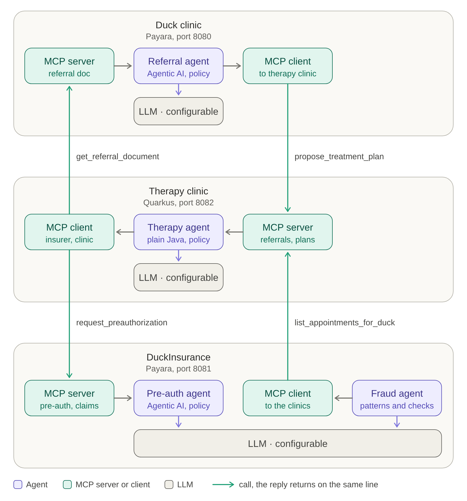

# Duck agents demo: purpose, setup and start

Nov 23, 2026, updated Nov 24, 2026 · @Han Solo

## Purpose

This demo shows how an existing Jakarta EE application gets AI capabilities one step at a time, without being rewritten. It follows a duck clinic, a duck insurer and a physical therapy clinic for ducks.

Each step builds on the previous one:

1. **MCP server on the duck-clinic.** The Jakarta MCP server library turns the clinic's existing services into MCP tools. Any MCP client can then read owners, ducks, vets and visits and book a visit, for example Claude CLI after the server is added to it. A separate voice demo does the same: a Swift app takes voice input and calls the Java application duck-voice-agent, whose MCP client reads from the clinic and books an appointment.
2. **DuckInsurance with an assistant.** A second Jakarta EE application, with its own MCP server and an MCP client. Its chat window (Assistant) lets employees work with the application by chatting instead of using the web pages. Anything that changes data is confirmed by the user first.
3. **A fraud agent.** For a claim, an agent asks the clinics what they have on record, compares that with the insurer's own data and gives the claim a score from 0 to 100 and a reason. Code first looks for patterns across all claims (the same wording, the same invoice twice, a very young policy, an amount near the limit, and more), and the model may ask for up to three extra read-only checks before it answers. The adjuster still decides to approve or decline.
4. **Agent to agent.** The third application, the Duck Physical Therapy Clinic, is a Quarkus application with the Quarkus MCP server, not Jakarta EE. Three agents in three applications decide together whether a duck needs further therapy and, if so, which sessions the insurer pays and which are booked.

The idea behind step 4: each institution keeps its own data, rules and limits, and only MCP calls cross between them. Code enforces the limits; the language model only chooses inside them.

For a live audience, an `admin` of DuckInsurance can switch steps 2 to 4 on and off with three small switches at the bottom of the sidebar (**AI**, **Fraud**, **A2A**), so the story can start with a plain Jakarta EE application.

## The applications

Three applications make up the demo: two Jakarta EE applications on Payara 7 and one Quarkus application. Each has its own data, MCP server, MCP client and agent.



The clinic and the therapy clinic call each other during a referral, the therapy clinic asks the insurer to pay, and the insurer's fraud agent reads both clinics.

| Application | What it does | Stack | Port | MCP endpoint | Agent |
| --- | --- | --- | --- | --- | --- |
| Duck Clinic | Owners, ducks, vets and visits; starts the referral to therapy | Jakarta EE 11, Payara 7 | 8080 | `http://localhost:8080/duck-clinic/api/mcp` | Referral agent |
| DuckInsurance | Policies and claims; Assistant chat; fraud check; pre-authorization | Jakarta EE 11, Payara 7 | 8081 | `http://localhost:8081/api/mcp` | Pre-authorization agent, fraud agent |
| Duck Physical Therapy Clinic | Treatments, therapists and appointments | Quarkus 3 with the Quarkus MCP server | 8082 | `http://localhost:8082/mcp` | Therapy agent |

The two Jakarta EE applications use the Jakarta MCP server library (`eu.hansolo.mcp:mcp-jakarta` 1.1.0, Maven Central) and the Jakarta MCP client (`eu.hansolo.mcp:mcp-jakarta-client` 0.3.0). Their agents use the draft Jakarta Agentic AI API that ships with Payara 7.2026.8 or newer. Each application supplies its own language model client, configured in `llm.env`, so the same model setting works with a local Ollama, the Claude API or any OpenAI-format service. Quarkus has no runtime for that API, so the therapy agent has the same steps as plain Java methods.

## Requirements

The shortest path needs Docker with Compose, a language model (a local Ollama, a Claude API key or an OpenAI-format service) and three free ports. Everything else is optional.

| Requirement | Needed for | Notes |
| --- | --- | --- |
| Docker with Compose 2.24 or newer | Running the three applications in containers | Docker Desktop, or Docker Engine with the Compose plugin on Linux. The compose files use `env_file` with `required: false`, which needs 2.24. The first start downloads the images, so it needs internet |
| A language model | All agents and the Assistant | One of: Ollama 0.14 or newer (default model `qwen3.8:27b`, `ollama pull qwen3.8:27b`, needs plenty of memory); the Claude API with a key; an OpenAI-format service such as OpenAI, Groq, OpenRouter or Mistral. Free tiers have small rate limits, use a paid tier for demos |
| Free ports 8080, 8081, 8082 | Clinic, insurer, therapy clinic | The insurer's Payara admin console also uses 4848 |
| JDK 21 or newer and Maven | Building and running without Docker; building duck-voice-agent | The clinic and the therapy clinic compile for release 21 |
| Payara 7.2026.8 or newer | The draft Jakarta Agentic AI API | The Docker images use 7.2026.10 |
| macOS 26 or newer | Optional: the prebuilt DuckVoice.app of the voice demo | Uses on-device speech recognition and a microphone |
| Node.js 20 or newer | Optional: `scripts/duckchat.mjs`, a terminal chat against the insurer |  |
| Claude CLI (Claude Code) | Optional: using the clinic's MCP server from a terminal |  |

With Ollama on Linux, start it with `OLLAMA_HOST=0.0.0.0 ollama serve`, so the containers can reach it. Docker Desktop needs nothing.

## Setup

There are two ways to run the demo. Sales people and anyone who only wants to show it use the **demo launcher**; developers who change the code run the three projects **from source**.

### With the demo launcher (prebuilt images)

The folder `duck-agents-demo` holds one `compose.yaml` for all three applications, one shared `llm.env`, and start, stop and reset scripts for macOS (`.command`), Windows (`.bat`) and Linux (`.sh`). The images are prebuilt and published by the maintainer, so nothing is compiled on the laptop.

1. Install Docker Desktop (or Docker Engine with Compose on Linux) and start it once.
2. Double-click `start-demo` (`./start-demo.sh` on Linux). The first time it creates `llm.env` from `llm.env.example` and opens it: fill in the model settings (below) and start again.
3. The script checks Docker, downloads the newest images, starts the three applications and opens them in the browser. `stop-demo` stops them; `reset-demo` also deletes the therapy clinic's bookings.

The launcher's own `README.md` (for sales) and `MAINTAINER.md` (images, `.env`, licensing, keys) have the details.

### From source

1. Put the three project folders side by side: the duck clinic (`duck-clinic-a2a`), DuckInsurance (`duckinsurance-a2a`) and the Duck Physical Therapy Clinic (`duckphysicaltherapyclinic-a2a`).
2. If you use Ollama, start it and load the model: `ollama pull qwen3.8:27b`.
3. In each project, copy `llm.env.example` to `llm.env`. Use the same values in all three, so every agent talks to the same model. No rebuild is needed after changing the file; run `docker compose up -d` again.

### Model settings (`llm.env`)

The same keys work in the launcher and in every project.

| | `LLM_PROVIDER` | `LLM_BASE_URL` | `LLM_MODEL` | `LLM_API_KEY` |
| --- | --- | --- | --- | --- |
| Local Ollama (default) | `ollama` | `http://host.docker.internal:11434` | `qwen3.8:27b` | any text |
| Claude | `anthropic` | `https://api.anthropic.com` | a Claude model name | Anthropic API key |
| OpenAI format | `openai` | the service URL with `/v1`, for example `https://api.openai.com/v1` or `https://api.groq.com/openai/v1` | that service's model name | that service's key |

Optional: `LLM_MAX_TOKENS` (with `anthropic` the default is 4096; with `openai` no limit is sent unless it is set). All three providers work for the agents and for the Assistant. How well a model uses tools and follows the JSON instructions depends on the model; small local models often stop after one step.

Leave `AGENT_SECRET` at its default (`duck-agent-demo`) unless you want another value. The clinic and therapy agents use it to call the insurer's partner tools, so the same value must reach all three applications.

The databases are created with seed data, so there is nothing to import. These settings can be changed in each project's `compose.yaml` or `docker-compose.yml` (in the launcher, the switch start values are in its `.env`):

| Setting | Application | Default |
| --- | --- | --- |
| `DUCKINSURANCE_PORT` | DuckInsurance | 8081 |
| `DUCKCLINIC_MCP_URL` | DuckInsurance | `http://host.docker.internal:8080/duck-clinic/api/mcp` |
| `PHYSIOCLINIC_MCP_URL` | DuckInsurance | `http://host.docker.internal:8082/mcp` |
| `DUCKCLINIC_REST_URL`, `PHYSIOCLINIC_REST_URL` | DuckInsurance | `http://host.docker.internal:8080/duck-clinic/api`, `http://host.docker.internal:8082/api` |
| `THERAPY_MCP_URL` | Duck Clinic | `http://host.docker.internal:8082/mcp` |
| `DUCK_ASSISTANT`, `DUCK_FRAUD_AGENT`, `DUCK_AGENTS_TAB` | DuckInsurance | `on`; start values of the **AI**, **Fraud** and **A2A** switches (`off` hides the Assistant, the fraud agent or the Agents page until an admin switches it on) |
| `DUCK_FRAUD_INVESTIGATE` | DuckInsurance | `on` (`off`: the fraud agent keeps the pattern signals but answers after one model call, for small rate limits) |
| `DUCK_CONFIRM_WRITES` | DuckInsurance | `if-supported` (also `always`, `off`) |

## Starting the applications

With the launcher, `start-demo` does all of this and opens the browser. From source, start Ollama first (if you use it), then the three applications with Docker Compose, each in its own terminal. The order does not matter much, because the applications only call each other when a referral or a check runs.

```
# in each project folder
docker compose up --build
```

The first build takes a few minutes. Wait for the log line that says the application is deployed, then open:

| Application | URL | Sign-in |
| --- | --- | --- |
| Duck Clinic | `http://localhost:8080/duck-clinic/` | none |
| DuckInsurance | `http://localhost:8081` | `admin/admin`, `adjuster/adjuster`, `customer/customer` |
| Duck Physical Therapy Clinic | `http://localhost:8082` (MCP `/mcp`, REST `/api`) | none |

Stop an application with `docker compose down` in its folder. The clinic and the insurer create fresh data whenever their container is new, so bookings made through MCP are gone after `docker compose down` and up again. If Docker only restarts an existing container (for example after a computer restart), the insurer keeps its data and does not seed it a second time. The therapy clinic keeps its H2 database in the Docker volume `clinic-data`; run `docker compose down -v` to re-seed it. It is seeded with 3 owners, 6 ducks, 2 therapists and 6 treatments, among them Sir Quacksalot and his owner Anna Keller. The therapy clinic also has a small web UI at `http://localhost:8082` for booking sessions, finding appointments and browsing treatments.

**Without Docker.** The clinic starts with `mvn clean package payara-server:start`; `liberty:run` and `wildfly:run -Pwildfly` also work. DuckInsurance builds with `mvn package` and runs on Payara Micro 7 with `java -jar payara-micro.jar --deploy target/duckinsurance.war`. The therapy clinic starts with `mvn quarkus:dev` and listens on 8082. The two Jakarta EE applications then both listen on 8080 by default, so give each its own port and set the URL settings from the Setup table to match.

**Check that it works.** In DuckInsurance, open **Assistant**: both dots at the top should be green (model reachable, MCP endpoint reachable). The first answer is slow because Ollama loads the model. The **Claims** page shows one indicator per clinic.

## Trying it out

Five ways in, in the order of the story. Each works on its own once the applications it needs are running.

### 1. Claude CLI on the clinic

Add the clinic's MCP server to Claude Code, then ask about the clinic in plain language.

```
claude mcp add --scope user --transport http duck-clinic http://localhost:8080/duck-clinic/api/mcp
```

The tools are `find_owners`, `list_vets`, `list_visits` and `book_visit`. Booking asks you to confirm first (an MCP elicitation), so the client must support that. The server speaks only MCP revision 2026-07-28 and has no `initialize` handshake; a client that needs one gets HTTP 400. The endpoint has no authentication, so keep it on localhost.

### 2. The Assistant in DuckInsurance

Sign in as `adjuster`, open **Assistant** and ask for something, for example "Approve the open claim of Don Quixote". The Assistant is an MCP client inside the application and acts with the role of the signed-in user. `issue_policy`, `submit_claim` and `decide_claim` show a **Please confirm** card; nothing changes before you answer yes.

### 3. The fraud agent

Needs the **Fraud** switch on. Sign in as `adjuster` (or `admin`), open **Claims** and press **Check** on an open vet-care or physiotherapy claim, then **Refresh**. The agent reads the records of both clinics, the insurer's code looks for patterns across all claims, and the model gives a score and a reason that starts with `[agentic-ai]`. If more evidence could change its score, the model asks for up to three checks from a fixed list (the owner's other claims, similar claims, the owner's policies, the owner's other ducks at the clinic, other claims naming the same vet); the code runs them read only and the model answers once more.

The result is one line under the score, for example "No clinic has a record near the incident. 6 signals · 3 checks". Click it to open the full reason, each signal and what each check found. The same steps appear on the **Agents** page under the claim number.

The demo data has three prepared cases:

- **Waddles** (Marcus Webb): a second arthritis claim. The code flags the repeat, but the clinic has both visits, so the score is low.
- **Sir Quacksalot**, "Fishing hook removal" (CLM-00010): the clinic has the surgery, but the same surgery was already claimed and paid. High score.
- **Admiral Beak** and **Puddles** (Samuel Okafor): almost the same wording, policies two weeks old, amounts near the limit, an earlier rejected claim and no clinic record. High score.

You can also sign in as `customer`, file a claim against a vet-care policy, and check it as `adjuster`. If the agent proposes a therapy booking, an adjuster or admin presses **Book it**; the agent never books by itself.

### 4. Agent to agent: the referral

Needs the **A2A** switch on. Sign in to DuckInsurance as `adjuster`, open **Agents** and start the referral for Sir Quacksalot, owned by Anna Keller. The page merges the logs of all three agents into one conversation and refreshes every 2 seconds. The referral id (REF-0001) travels through every call.

To start it from a terminal instead, post the duck and the owner's consent. The answer is 202 with a referral id, and the conversation follows in `/duck-clinic/api/agent/log`.

```
curl -X POST http://localhost:8080/duck-clinic/api/referrals \
  -H 'Content-Type: application/json' \
  -d '{"ownerLastName":"Keller","duckName":"Sir Quacksalot","ownerConsent":true}'
```

1. The clinic agent checks the visits of the last 90 days and the owner's consent, writes the referral and hands it to the therapy clinic (`propose_treatment_plan`).
2. The therapy agent picks treatment, therapist and sessions, and asks the insurer to pay (`request_preauthorization`), without the referral document.
3. The insurer needs the document, so the call answers `input_required` instead of failing. The therapy agent asks the clinic for it (`get_referral_document`), and the clinic asks for confirmation before it releases the document.
4. The insurer agent answers approved, partial or denied, within the limits the code computed. With 75 EUR as the most it pays per session, an 85 EUR plan can only be partly approved.
5. The therapy agent books only the approved sessions and reports back to the clinic.
6. After each session, press the button that completes the next appointment. The therapy clinic bills it (`submit_provider_claim`) and the insurer's fraud agent asks both clinics whether the visit happened.

### 5. Voice: DuckVoice and duck-voice-agent

This is a separate demo on top of the clinic's MCP server: you speak, a Java agent works with the clinic, and the answer is read aloud. It needs only the clinic from the Docker setup, not the insurer or the therapy clinic.

- **duck-voice-agent** (Java, JDK 21, MCP client `mcp-jakarta-client` 0.3.0) is the brain. It calls the model, reads and books through the clinic's MCP tools, and asks for confirmation before it books.
- **DuckVoice** (Swift, macOS 26 or newer) is the front end: microphone, on-device speech recognition and spoken replies. It starts the Java agent with `--json` and exchanges JSON lines with it. The app is already built: download `DuckVoice.zip` from [github.com/HanSolo/duckvoice](https://github.com/HanSolo/duckvoice), which also has the source.

To run it:

1. Make sure the clinic answers on `http://localhost:8080/duck-clinic/api/mcp` (it does after `docker compose up --build`).
2. In the duck-voice-agent folder, build the agent with `mvn -q package`. This produces `target/duck-voice-agent.jar`.
3. Create `~/.duck-voice.env` with one `KEY=value` per line. For the local Ollama:

```
DUCK_AGENT_JAR=/full/path/to/duck-voice-agent/target/duck-voice-agent.jar
ANTHROPIC_BASE_URL=http://localhost:11434
ANTHROPIC_API_KEY=ollama
ANTHROPIC_MODEL=qwen3.8:27b
ANTHROPIC_MAX_TOKENS=4096
MCP_URL=http://localhost:8080/duck-clinic/api/mcp
```

4. Start `DuckVoice.app` on the machine that runs the demo (unzip DuckVoice.zip first).
5. Press **Talk** (or Space), speak, and press **Done**. For example: "Book Daisy for next Tuesday, annual checkup." The agent reads the booking back and waits for a spoken or on-screen answer. Only a clear yes ("yes", "yeah", "book it", "correct", "confirm") books; anything else is a no.

The first run asks for microphone access and downloads the on-device speech model. Without the Swift app, run `java -jar target/duck-voice-agent.jar` with the same settings as environment variables (at least `ANTHROPIC_API_KEY` and `ANTHROPIC_MODEL`) for a typed version of the same conversation.

## Troubleshooting and limits

Most problems come from the model server not being reachable or from a port that is already taken.

| Symptom | Likely cause | What to do |
| --- | --- | --- |
| Assistant shows a red model dot | The container cannot reach the model | Check `LLM_PROVIDER`, `LLM_BASE_URL` and `LLM_API_KEY` in `llm.env`. For Ollama: `ollama --version` (0.14 or newer); on Linux start it with `OLLAMA_HOST=0.0.0.0` |
| Assistant, Claims check or Agents page is missing | Its demo switch is off | Sign in as `admin` and switch **AI**, **Fraud** or **A2A** on at the bottom of the sidebar |
| "The model returned no answer" | A thinking model used the whole answer limit | Raise `LLM_MAX_TOKENS`, or for Ollama use `LLM_PROVIDER=ollama`, which switches thinking off |
| An error mentions a rate limit (HTTP 429) | The model service's free tier is used up for the minute | The agents wait up to 30 seconds and retry once. Check one claim at a time, use a paid tier, or set `DUCK_FRAUD_INVESTIGATE=off` |
| No details open under a fraud score | The insurer was restarted since the check; the details live in memory | Press **Check** again |
| First answer takes very long | Ollama is loading the model | Ask one question before the audience arrives |
| Claims page shows a clinic as unreachable | The clinic is not running or the URL is wrong | Check ports 8080 and 8082 and the `*_MCP_URL` settings |
| Fraud reason starts with `[rules]` | The model did not answer in the expected JSON, so a fixed rule decided | Run the check again or try another model |
| A port is in use | Another application holds 8080, 8081 or 8082 | Change `DUCKINSURANCE_PORT`, or stop the other application |
| Referral gone after a restart | Referrals, plans, pre-authorizations and agent logs live in memory | Start the referral again |

### Limits

- Authentication is demo grade: the clinics' MCP endpoints are open, the insurer's partner tools use a shared secret, and the accounts have plain-text passwords. Keep everything on localhost.
- The model decides, so two runs of the same referral can differ.
- Ducks are matched across the applications by owner last name plus duck name. Two owners with the same last name and a duck of the same name would be confused.
- The Jakarta Agentic AI API is a draft and may change. Payara 7.2026.10 has no OpenAI backend, so the applications supply their own model client instead of Payara's model settings.
- The fraud agent's pattern signals are hints computed by simple rules (for example word overlap for "same wording"), not proof. The details under a score live in memory and are gone after a restart.
