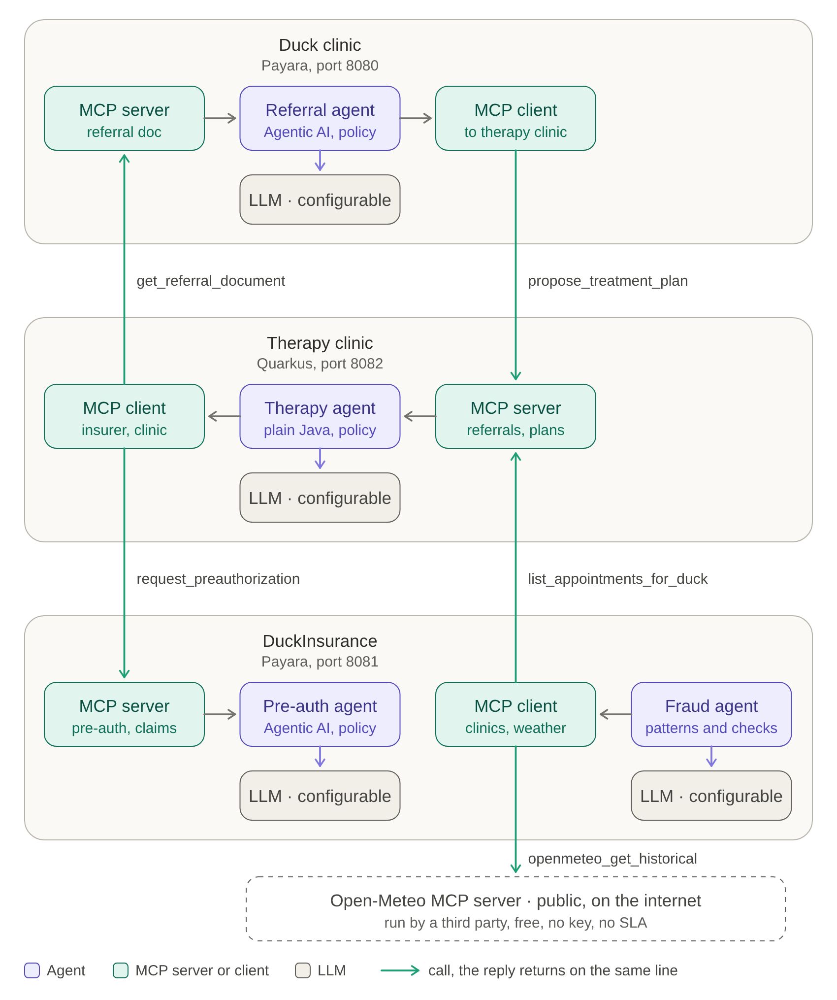
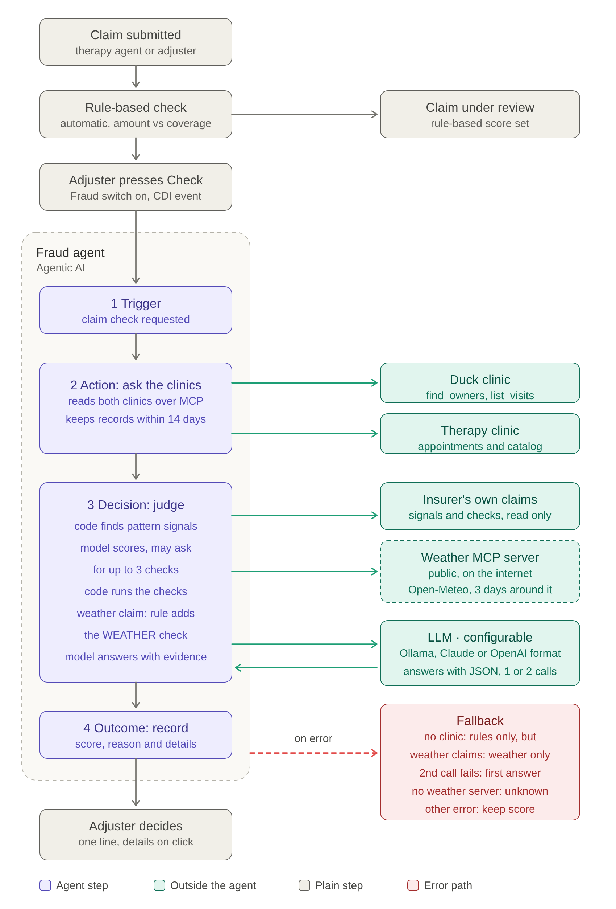

# Duck agents: how the three institutions talk to each other

Nov 21, 2026, updated Nov 25, 2026 · @Han Solo

## Overview

Three duck institutions each run their own agent, and one referral makes the three agents talk to each other. The agents do not share a database or a model: every institution keeps its own data, its own written policy and its own limits, and the agents only exchange what the other side asks for, through MCP tools.

The story: Sir Quacksalot, a mallard owned by Anna Keller in Zurich, had emergency surgery on 2026-10-11 to remove a fishing hook from the crop. A vet asks the duck clinic's agent whether to refer her to physiotherapy. The clinic agent says yes and hands the case to the physical therapy clinic's agent. That agent plans a treatment, asks the insurer's agent whether DuckInsurance will pay, and books only the sessions the insurer approves. The insurer caps its payment at 75 EUR per session, so a plan priced at 85 EUR can at best be approved partially.

## The three institutions and their agents

Each agent decides inside limits that the code enforces. The model chooses within those limits, and the code clamps whatever it answers.

| Institution | App | Agent | What it decides | Limits the code enforces |
| --- | --- | --- | --- | --- |
| Duck clinic (the vet) | Jakarta EE on Payara 7, DuckDB, port 8080 (`/duck-clinic`) | Clinic Agent (`ReferralAgent`, Jakarta Agentic AI) | Whether to refer the duck, and for how many sessions | Owner consent on file, at most 6 sessions, a visit in the last 90 days, no open referral for the same duck |
| Duck physical therapy clinic | Quarkus 3, port 8082 | Therapy Agent (`TherapyAgent`, plain steps with its own model client) | Which treatment and therapist fit the diagnosis, and how many sessions | At most the requested sessions and never more than 6, one treatment and one therapist from the catalogue, working days 08:00 to 18:00, sessions at least 2 days apart, first session at least 2 days ahead, only approved sessions are booked |
| DuckInsurance | Jakarta EE 11 on Payara 7, port 8081 (`/api/mcp`) | Insurance Agent (`PreauthAgent`, Jakarta Agentic AI) | How many sessions to approve, from 0 up to the number the rules allow | Active PHYSIO policy, 14-day waiting period, referral document required, at most 6 sessions, at most 75 EUR per session, remaining coverage not exceeded, first session within 30 days |

All three agents use the same pattern and the same language model, set once in `llm.env`: a local Ollama, the Claude API or an OpenAI-format service. The clinic and the insurer use the Jakarta Agentic AI API (trigger, action, decision, outcome), which Payara runs. Quarkus has no runtime for that API, so the therapy agent has the same steps as plain methods.

## How the three institutions interact

&#91;embedded content: referral and cancellation flow · 3 institutions, 18 messages\]

Read it top to bottom. Solid arrows are calls, dashed arrows are replies, and the two highlighted replies are the insurer and the clinic asking back inside the same call before it can be answered. Messages 1 to 13 are the referral, from the vet's question to the first claim. Messages 14 to 18 are the cancellation after the first session.

The same system seen as architecture instead of conversation. Each institution is a closed box with its own agent, its own MCP server and client, and its own call to the configured LLM. The four teal arrows between the boxes are the only places where data crosses an institution boundary, and the tool name on each arrow says what is asked. The fifth arrow leaves the demo: for claims that blame the weather, the insurer's fraud agent asks a public weather MCP server on the internet that none of the three institutions runs.

## The conversation step by step

1. **Question.** The vet asks the Clinic Agent whether to refer the duck. The agent collects the facts (visits in the last 90 days, whether a referral is already open) and asks the model whether a referral makes sense and for how many sessions. It answers the vet and assigns the shared id `REF-nnnn`.
2. **Hand-over.** The Clinic Agent calls `propose_treatment_plan` on the therapy clinic. It sends only the diagnosis summary, the suggested number of sessions and the fact that the owner consented. The Therapy Agent answers at once that it received the referral and plans in the background.
3. **Planning.** The Therapy Agent reports `PLANNING` to the clinic with `report_referral_status`, finds the duck in its own records, asks the model which treatment, therapist and number of sessions fit the diagnosis, and looks up free slots.
4. **Insurance question.** The Therapy Agent calls `request_preauthorization` on the insurer with the treatment, the price per session and the first session date. It attaches no referral document.
5. **The insurer asks back.** The insurer's rules say a referral document is required. Instead of failing, the call answers `input_required` and asks for the document inside the same call.
6. **Document release.** The Therapy Agent does not own the document. It calls `get_referral_document` on the clinic, and the clinic asks back whether the release is confirmed. The Therapy Agent confirms, because it holds the referral and the insurer needs the document, and the clinic releases the diagnosis and recent visits.
7. **Decision.** The Therapy Agent repeats the insurer call with the document. The Insurance Agent computes the policy facts, asks the model how many sessions are reasonable, and the code clamps the answer to its limits. The result is `APPROVED`, `PARTIAL` or `DENIED`.
8. **Booking.** For `APPROVED` or `PARTIAL` the Therapy Agent books exactly the approved number of sessions and reports `SCHEDULED` to the clinic. For `DENIED` it books nothing and reports `NOT_COVERED` with the insurer's reason.
9. **Billing.** After each completed session the Therapy Agent calls `submit_provider_claim`. The insurer files a claim for at most the approved amount per session and gives it a rule-based fraud score. An adjuster can then start the fraud agent, which asks the clinics to confirm the visit.

When the insurer's model takes longer than the connection stays open, the Therapy Agent does not give up: it polls `get_preauthorization` until the insurer's stored answer appears, for at most four minutes.

**Cancelling.** The vet can cancel a scheduled referral. The Clinic Agent asks the Therapy Agent with `cancel_referral`. The rule is the same in every institution: sessions that are completed stay billed, sessions that are still booked are cancelled, and the Therapy Agent asks the Insurance Agent with `release_preauthorization` to release the coverage reserved for those sessions. The clinic hears `CANCELLED`, and a new referral for the same duck is possible again. In the demo, a referral with 4 booked sessions and 1 completed one ended with 3 cancelled sessions and 1 billed session.

## The fraud agent in DuckInsurance

DuckInsurance has a fourth agent, the fraud agent. It is not part of the referral conversation: it judges claims, whether they come from the Therapy Agent or from an adjuster. Every new claim first gets an automatic rule-based score. The agent runs only when an adjuster presses Check on a claim, and only while the **Fraud** demo switch is on.

- **Trigger and action.** The Check button fires a CDI event. The agent finds the duck by owner last name and duck name in both clinics and reads its visits and appointments over MCP. It keeps only records within 14 days of the incident. A clinic it cannot reach is unknown, not suspicious.
- **Pattern signals.** Before the model is asked, the insurer's code compares the claim with all other claims and lists facts: almost the same wording as another claim, the same duck claimed again within 7 days with almost the same amount (the same invoice twice) or a different one (one treatment split up), an earlier rejected claim of the owner, other claims for the same duck or the owner's other ducks within 90 days, an incident within 30 days of the policy start, an amount of 90% of the coverage or more, and an amount of at least twice the usual for that policy type. Code counts, because a model is unreliable at comparing many records; the model only weighs the signals, and a matching clinic record outweighs a repeat claim unless the same invoice may have been claimed twice.
- **Decision, with investigation.** The model gets the claim, the records and the signals and answers with JSON: a score from 0 (plausible) to 100 (very suspicious), a reason, optionally a treatment and a therapist, and optionally up to three checks it wants from a fixed list: the owner's other claims, similar claims of any owner, the owner's policies, the owner's other ducks at the clinic, other claims naming the same vet. The code runs those checks read only and asks the model once more with the evidence. Unknown names are ignored.
- **Weather, from a public MCP server.** If the description blames the weather (hail, thunderstorm, storm, heavy rain or flood, frost or snow, heat), the code adds the signal `WEATHER_EVENT` and a sixth check, `WEATHER`, is on the list. If the model does not ask for it, the insurer's rule adds it, and the log says so, because small local models often don't ask. The check calls the free, keyless Open-Meteo MCP server at `https://open-meteo.caseyjhand.com/mcp` (tools `openmeteo_search_locations` and `openmeteo_get_historical`) for the owner's town, from the day before to the day after the incident. Here DuckInsurance is the MCP client of a server somebody else runs on the internet, with the same MCP client library it uses for the clinics. The code reads the numbers (hail needs a thunderstorm, weather code 95 to 99; a storm needs gusts of about 75 km/h; heavy rain about 20 mm a day; frost 0 °C or snow; heat 30 °C), and the model gets the three days plus that reading. Answers are cached in memory per town and date. Because this is plain text in and out rather than tool calling, it works the same with every model provider. The code clamps the score to 0 to 100, and if the answer cannot be read, a rule decides.
- **Outcome.** The score and reason are stored on the claim, which stays under review. In the claim list the result is one line with the number of signals and checks; a click opens the full reason, each signal and what each check found. If neither clinic has the treatment but the duck is a patient of the therapy clinic, the agent adds a booking proposal that an adjuster can accept.
- **Errors.** Without any reachable clinic the claim keeps the rule-based score and says so, unless the claim blames the weather and the weather server answers; then the agent checks the weather only, and the prompt says that no clinic could be reached (which tells nothing about the claim). If the weather server cannot be reached, the weather counts as unknown and the model is told not to hold that against the claim. If only the second model call fails, for example on a rate limit, the first answer counts and the details say why. Any other failure is noted on the claim and the earlier score stays.

The **Claims** page shows whether the agent can reach its sources: one indicator per clinic and a third for the weather server (green when it answers, red when not, yellow when `WEATHER_MCP_URL=off` switches the check off).

The demo data contains four prepared cases: a repeat claim for Waddles that the clinic confirms (low score), Sir Quacksalot's hook surgery claimed a second time (high score), two near-identical emergency claims for Samuel Okafor's ducks with young policies, an earlier rejection and no clinic record (high score), and hail injuries for Ducky McDuckface in Vienna 12 days ago. Hail needs a thunderstorm, which is rare in Vienna and almost never happens outside summer, so on nearly every day the real weather contradicts that claim (high score); after a real thunderstorm the agent will correctly find it plausible.

## How an agent decides

All three agents follow the same four rules, so the demo behaves the same way in every institution.

- **The code sets the limits.** Consent, session caps, price caps, waiting periods and coverage are computed and enforced in code. The model cannot override them.
- **A policy file is the model's instructions.** Each institution has a plain-language policy (`clinic-agent-policy.md`, `therapy-agent-policy.md`, `insurer-agent-policy.md`) that is fed to the model. Changing the behaviour of an agent means editing its policy text.
- **The model chooses inside the limits.** It answers with JSON, for example the number of approved sessions and a reason. The code clamps the answer to the allowed range.
- **The code answers without the model when a rule decides.** For example, a missing referral document or a policy still inside its waiting period is answered by the rules, and the agent log marks it as decided by the rules.

## The protocol between the agents

The agents talk through MCP tools over Streamable HTTP, using the stateless 2026-07-28 version of the protocol: every call is one POST with the protocol version, client info and client capabilities in its `_meta`, and there is no handshake and no session.

| Tool | Offered by | Called by | Purpose |
| --- | --- | --- | --- |
| `propose_treatment_plan` | Therapy clinic | Clinic Agent | Hands over the referral and starts the planning |
| `cancel_referral` | Therapy clinic | Clinic Agent | Cancels a scheduled referral: booked sessions are cancelled, completed ones stay billed |
| `get_plan_status`, `complete_appointment` | Therapy clinic | Clinic side, demo page | Shows the plan, completes a session |
| `request_preauthorization` | Insurer | Therapy Agent | Asks whether the insurer pays for the plan |
| `get_preauthorization` | Insurer | Therapy Agent | Reads the stored answer, used when the connection broke |
| `submit_provider_claim` | Insurer | Therapy Agent | Bills one completed session |
| `release_preauthorization` | Insurer | Therapy Agent | Cancels the pre-authorization and releases the coverage reserved for sessions that were not claimed |
| `get_referral_document` | Duck clinic | Therapy Agent | Releases the referral document for the insurer |
| `report_referral_status` | Duck clinic | Therapy Agent | Reports PLANNING, SCHEDULED, NOT\_COVERED, REJECTED, IN\_TREATMENT, COMPLETED or CANCELLED |

**Multi round-trip requests.** A tool can answer `input_required` with a question instead of a result. The caller answers the question and repeats the same call with its answers and a signed `requestState`. The demo uses this twice: the insurer asks for the referral document inside `request_preauthorization`, and the clinic asks for a confirmation inside `get_referral_document`. The state is signed, so the caller cannot change the original request between the rounds.

**Who may call.** The insurer accepts only a bearer token of the form `therapy-agent:<secret>` or `clinic-agent:<secret>`, which gives the role AGENT. The clinics' MCP endpoints are open in the demo.

**What is shared.** The owner's consent is checked before a referral is sent. The first message carries only the diagnosis summary. The full referral document goes out only after the insurer asked for it and the clinic confirmed the release. The institutions identify a duck by owner last name and duck name, because their internal ids differ, and by the shared referral id `REF-nnnn` that the clinic assigns.

## Watching it run, and known limits

The **Agents** page in DuckInsurance (sign in as an adjuster; an admin shows or hides it with the **A2A** switch) merges the in-memory logs of all three agents into one conversation, newest at the bottom, and refreshes every 2 seconds. Each entry shows who spoke, to whom, and its kind: REQUEST, ANSWER, THOUGHT, POLICY, ACTION or ERROR. The buttons start the referral for Sir Quacksalot (the full path) or for Don Quixote (the clinic declines by its own rule), complete the next session, cancel the referral and reset the logs. Completing and cancelling are available only once a referral is scheduled.

Known limits of the demo:

- The model decides, so two runs can differ. The insurer may deny a plan that the therapy agent considers fitting, and the policy texts steer this.
- The insurer's model call can take longer than a connection stays open. The Therapy Agent then polls `get_preauthorization` for the stored answer.
- State and logs are kept in memory and are lost on restart, and so are the details under a fraud score (the score and reason stay).
- Ducks are matched by owner last name and duck name, and the clinics' MCP endpoints have no authentication yet.
- The weather server is free, run by a private person and has no uptime promise; the weather data (Open-Meteo.com, CC BY 4.0) is free for non-commercial use only. A company sales demo may count as commercial; Open-Meteo sells an API key, and the open-source server can be self-hosted with it. The place is the owner's town, because claims have no location field.
- Cancelling works only for a scheduled referral, not while the therapy agent is still planning. Not built yet: per-agent authentication between all three apps.
